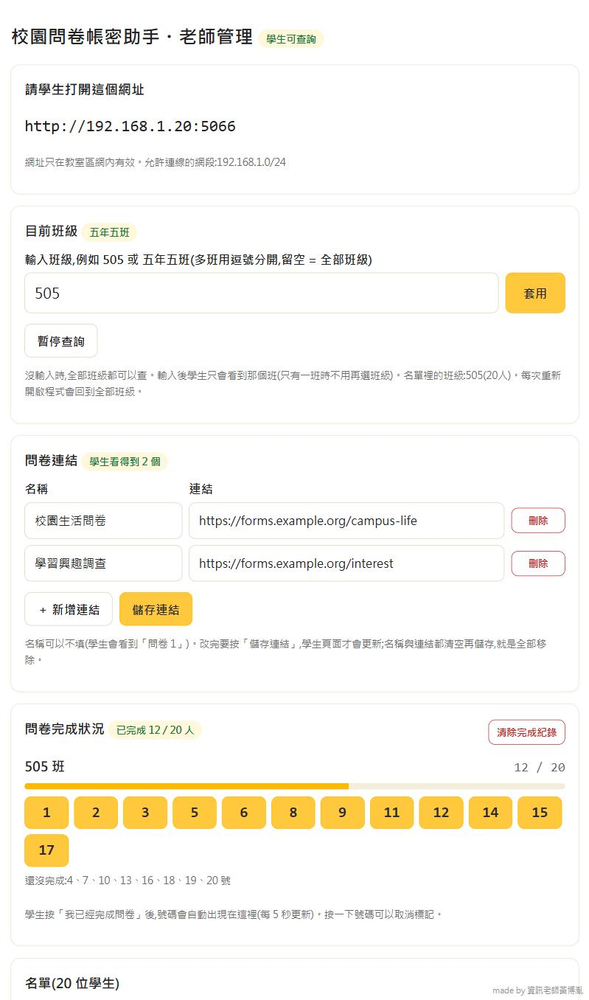
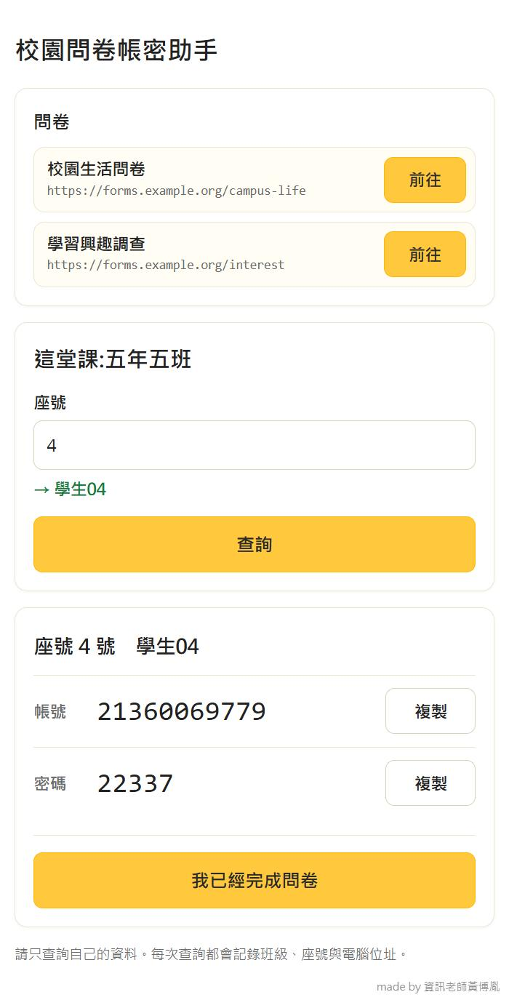

# 校園問卷帳密助手

電腦課學生用「班級 + 座號」查到問卷的帳號與密碼,按「複製」就能貼上;做完按「我已經完成問卷」,老師的管理頁即時看到完成的座號。程式只跑在老師電腦上,區網專用,上課才開。

## 特色

- **點一個檔就能用**:連點 `啟動.bat`。Python 環境已放在 `runtime/`,不用安裝、不用網路,整個資料夾放隨身碟到任何 Windows 電腦都能跑。
- **老師管理頁**:上傳教育局的 Excel(`.xls` / `.xlsx`)名單、選「目前班級」(505、五年五班、5年5班 都行)、放多個問卷連結、看每班完成與未完成的座號。管理頁不用密碼,但只有老師電腦本機打得開。
- **學生查詢頁**:座號可輸入也可下拉選,同時顯示姓名對照;只會拿到座號、姓名、帳號、密碼。
- **資安與隱私優先**:資料只存在老師電腦、加密保存、只對教室區網開放、完全不連外網。威脅與對策、已知限制見下方〈[資安與隱私說明](#資安與隱私說明)〉。
- 白底黃色按鈕的明亮介面,手機寬度也能用。

## 畫面與使用步驟

> 以下畫面都是示範用的假資料。

### 老師:管理頁



1. 連點 `啟動.bat`,瀏覽器會自動打開管理頁(第一次若跳出 Windows 視窗問是否允許,按「是」)。
2. 第一次先在頁面下方上傳名單 Excel(範例格式見 `sample/`)。
3. **請學生打開這個網址**:最上面那行網址投影給學生,他們的電腦必須和老師在同一個區網。
4. **目前班級**:輸入 `505` 或 `五年五班` 再按「套用」,學生就只看得到那一班;留空代表全部班級都能查。
5. **問卷連結**:每列填「名稱」和「連結」,按「＋ 新增連結」可以加更多列,最後按「儲存連結」。
6. **問卷完成狀況**:學生按「我已經完成問卷」後,座號會自動出現在這裡,下面列出還沒完成的座號;按錯可以點座號取消。

### 學生:查詢頁



1. 在最上面點問卷旁邊的「前往」,打開問卷。
2. 輸入座號,或從下拉清單選;輸入後會顯示姓名,讓學生核對是不是自己。
3. 按「查詢」,出現帳號與密碼,各有一個「複製」按鈕,貼到問卷登入欄位即可。
4. 問卷做完,按「我已經完成問卷」,老師的畫面就會看到這個座號。

### 快速開始

1. 下載整個 repo(Code → Download ZIP)並解壓縮。
2. 連點 `啟動.bat`,上傳名單,把網址給學生。

詳細說明見 [使用說明.txt](使用說明.txt)。

## 資安與隱私說明

這個工具處理的是學生名單與問卷帳密,所以設計時依三個原則:**資料不離開老師電腦**、**只對教室區網開放**、**學生只拿到必要的資料**。下面把做了什麼、沒做什麼、哪裡有限制都寫清楚,方便資安背景的老師自行評估。

### 做了哪些防護

| 風險 | 對策 |
|---|---|
| 校外或網際網路連入 | 防火牆規則只放行本機所在子網路(`remoteip=LocalSubnet`),程式內再檢查來源 IP 是否在允許網段(預設為老師電腦所在 /24)。可用手機行動網路開學生網址驗證,應該打不開。 |
| 學生打開老師管理頁、改動名單 | `/admin` 只接受**來源是本機(127.0.0.1)**且 **Host 為 localhost / 127.0.0.1 / ::1** 的請求,其他電腦一律回 403;檢查 Host 同時擋掉 DNS rebinding。管理頁因此不需要密碼,也不存在可被猜的密碼。 |
| 偽造請求(CSRF) | 管理頁每個 POST 都要帶 session 內的 CSRF token(以常數時間比對);Cookie 設為 `HttpOnly`、`SameSite=Strict`;session 金鑰每次啟動重新產生。 |
| 猜座號、大量查詢 | 每台電腦每分鐘最多 30 次,超過就封鎖一分鐘(可在 `settings.json` 調整);每次查詢與完成回報都寫入查詢紀錄,可追溯。 |
| 硬碟上的檔案被複製 | 名單與完成紀錄用 Fernet(AES-128-CBC + HMAC-SHA256,`cryptography` 套件)加密存檔;金鑰檔再用 **Windows DPAPI** 綁定這台電腦的這個 Windows 帳號。整個資料夾複製到別台電腦或別的帳號,讀不出來。 |
| XSS、頁面注入 | 樣板自動跳脫,前端以 `textContent` 渲染;CSP 設為 `default-src 'self'`、`frame-ancestors 'none'`、`form-action 'self'`、`base-uri 'none'`;問卷連結只接受 `http://`、`https://`。 |
| 查詢紀錄的 CSV 公式注入 | 學生輸入的班級、座號會寫進 `query_log.csv`;開頭是 `=` `+` `-` `@` 的內容會加單引號中和,老師用 Excel 打開不會被執行。 |
| 惡意或過大的上傳 | 上傳只有老師本機能做,上限 10 MB,格式錯誤顯示錯誤訊息而不是當機。 |
| 瀏覽器端洩漏 | 回應標頭加上 `Cache-Control: no-store`、`X-Content-Type-Options: nosniff`、`Referrer-Policy: no-referrer`。 |

### 學生端拿到什麼(資料最小化)

- 查詢結果只有:座號、姓名、帳號、密碼。學號、學校代碼等其他欄位**不會送到學生電腦**。
- 為了讓學生核對是不是自己,開放班級的「座號 + 姓名」清單學生看得到(座號下拉選單)。這是刻意的設計。
- 老師可以只開放當堂課的班級,或按「暫停」立刻關閉所有查詢。
- 查詢紀錄(`data/query_log.csv`)記錄時間、來源電腦 IP、班級、座號、結果,**不含密碼**。這個檔案本身沒有加密,內含 IP 與座號,請當作個資處理。

### 不連外網

- 程式沒有任何對外連線、遙測、更新檢查或雲端服務,頁面也不載入任何外部字型、腳本或圖片(CSP 同時限制)。
- 程式中唯一特別的 socket 用法,是用 UDP `connect` 向私有位址查詢本機路由來找出老師電腦的區網 IP,這個動作不會送出任何封包。
- 第一次啟動會用 UAC 要求系統管理員權限,**只為了新增一條防火牆規則**(規則名稱 `ClassroomLookup-LAN-only`,只開放使用中的連接埠給同一子網路)。

### 已知限制(請先了解)

1. **沒有逐一驗證學生身分。** 知道「班級 + 座號」的人就能查到該座號的帳密,同班同學之間可以互查。這個工具的前提是帳密本身是問卷用途、風險有限;緩解方式是只開放當班、上課才開、查詢紀錄可追溯、可隨時暫停。若貴校要求更嚴格的身分驗證,需要搭配其他機制。
2. **區網內是 HTTP,沒有 TLS。** 同一網段有人做封包側錄時,查詢內容(含帳密)可被看見。請只在教室可信任的網路使用,不要在公用 Wi-Fi 或不受管理的網路上使用。
3. **加密只保護「靜態的檔案」。** 程式執行中,名單會以明文存在記憶體;DPAPI 防不了在同一個 Windows 帳號下執行的惡意程式,也防不了能登入老師帳號的人。老師電腦請鎖定螢幕、不共用帳號。
4. **「我已經完成問卷」是學生自我回報**,沒有與問卷系統核對;學生也可能替別人按,老師可在管理頁取消標記。
5. **速率限制以來源 IP 計算**,若多台電腦經過同一個 NAT,會被視為同一台。
6. **內附的 Python 與套件是固定版本,不會自動更新**(見下表)。若有安全性更新,需要自行替換 `runtime/`。
7. **沒有經過第三方資安稽核。** 目前有 104 項自動測試(含上述各項防護),但這不等於獨立的滲透測試。歡迎有資安背景的老師檢視原始碼並回報問題。

### 內附元件版本

| 元件 | 版本 |
|---|---|
| Python(embeddable) | 3.12.8 |
| Flask / Werkzeug / Jinja2 | 3.1.3 / 3.1.9 / 3.1.6 |
| waitress | 3.0.2 |
| cryptography | 50.0.2 |
| openpyxl / xlrd | 3.1.5 / 2.0.2 |

### 給老師的操作建議

- 名單 Excel 用完就從電腦刪除,**不要放進這個資料夾**,更不要 commit 到 Git(`.gitignore` 已擋掉 `data/` 與根目錄的 Excel)。
- 下課按管理頁的「下課:關閉程式」;學期結束按「刪除全部名單」,並刪除 `data/` 資料夾。
- 要搬移或分享整個資料夾前,先確認 `data/` 裡沒有真實資料。
- 本工具是否符合貴校的個資與資安規範,請依校內規定自行評估。

### 回報問題

發現資安問題請到 GitHub 的 Issues 通知,**但不要在公開頁面貼上漏洞細節或任何真實名單**;可以先只寫「有資安問題」,再約定私下說明的方式。

## 自動測試

```
runtime\python\python.exe tests\test_app.py
```

用暫存資料夾跑完整檢查,最後印出 `ALL OK`。

## 結構

| 路徑 | 內容 |
|---|---|
| `app.py` | 後端(Flask + waitress) |
| `templates/`、`static/` | 學生頁與管理頁 |
| `runtime/` | 內附的 Python 3.12 與套件 |
| `sample/` | 範例名單(假資料) |
| `tests/` | 自動測試 |

真實名單與 `data/` 內容不在 repo 內,也請不要把它們放進來。

made by 資訊老師黃博胤
